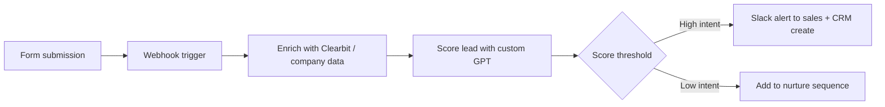

# Workflow Automation Toolkit

Automation flows and AI prompt templates for the lead handling and reporting work that shouldn't need a human doing it manually. Built around Make and n8n, the tools I use for this at [motabar.builds.stuff](https://motabar.builds.stuff).

## The problem this solves

Most teams have leads sitting in a form submission for hours before anyone follows up, and no consistent way to qualify or route them. This toolkit automates the handoff from form submission to a scored, enriched, routed lead in the right person's inbox within minutes.

## Architecture

## What's in here

* `flows/lead_enrichment_flow.json` a Make.com blueprint that triggers on form submission, enriches the lead with firmographic data, and routes based on score
* `prompts/custom_gpt_lead_qualifier.md` the system prompt used to score inbound leads on fit and intent before they hit a human's inbox

## How it's used in practice

The webhook catches the form submission the moment it happens rather than on a polling schedule, so there's no delay before enrichment starts. Enrichment pulls company size, industry, and role so the qualifier isn't scoring on form fields alone. The qualifier prompt is deliberately conservative, a lead only gets routed straight to sales as high intent when it's a clear fit, everything ambiguous goes to nurture rather than risking a bad lead landing on a rep's desk.

## Stack

Make, n8n, Clearbit API, OpenAI API, Slack, HubSpot
