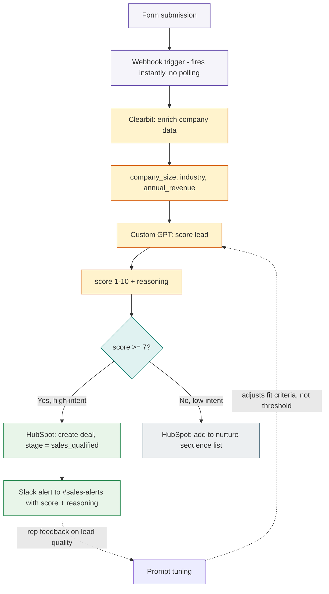

# Workflow Automation Toolkit

Automation flows and AI prompt templates for the lead handling and reporting work that shouldn't need a human doing it manually. Built around Make and n8n, the tools I use for this at [motabar.builds.stuff](https://motabar.builds.stuff).

## The problem this solves

Most teams have leads sitting in a form submission for hours before anyone follows up, with no consistent way to qualify or route them, which means a sales rep either follows up on everything (wasting time on low-fit leads) or relies on gut instinct to triage (missing good ones). This toolkit automates the handoff from form submission to a scored, enriched, routed lead landing in the right person's inbox within minutes, with the qualification logic made explicit and tunable instead of living in someone's head.

## Architecture

The feedback loop at the bottom is intentional: when sales flags a lead as a bad fit despite scoring high, the fix is tightening the fit criteria written into the prompt, not lowering the score threshold. Lowering the threshold just moves the same problem to a different score band.

## What's in here

* `flows/lead_enrichment_flow.json` a Make.com blueprint that triggers on form submission, enriches the lead with firmographic data, scores it, and routes based on that score
* `prompts/custom_gpt_lead_qualifier.md` the system prompt used to score inbound leads on fit and intent before they hit a human's inbox, along with notes on how to tune it

## How it's used in practice

The webhook catches the form submission the moment it happens rather than on a polling schedule, so there's no delay before enrichment starts. Enrichment pulls company size, industry, and role so the qualifier isn't scoring on form fields alone, a message with strong language but from a one-person company reads very differently once industry and size are in the picture. The qualifier prompt is deliberately conservative, a lead only gets routed straight to sales as high intent when there's a clear signal on both fit and urgency, everything ambiguous goes to nurture rather than risking a bad lead landing on a rep's desk and eroding trust in the automation.

## Why routing is binary instead of a full lead-scoring scale

A five-tier scoring system sounds more sophisticated but in practice just moves the judgment call to whoever's reading the score instead of resolving it. Binary routing forces the qualification logic to actually be decided and written into the prompt, which is also what makes it auditable and improvable over time.

## Setup

1. Set up a Make.com account and import `flows/lead_enrichment_flow.json` as a starting blueprint
2. Connect Clearbit, OpenAI, HubSpot, and Slack credentials in Make
3. Paste the prompt from `prompts/custom_gpt_lead_qualifier.md` into the OpenAI module
4. Point the webhook trigger at your form's submission endpoint

## Stack

Make, n8n, Clearbit API, OpenAI API, Slack, HubSpot
